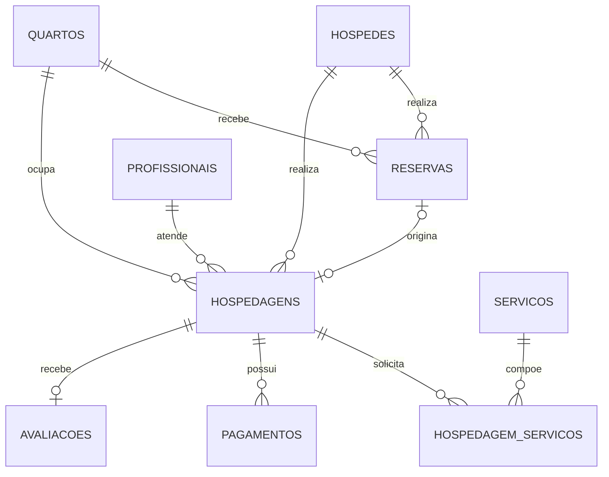

# 🌌 Hotel Nebula — Sistema de Gestão Hoteleira (Banco de Dados)

Projeto de modelagem, implementação e análise de dados desenvolvido para estruturar digitalmente as operações da rede **Hotel Nebula**, centralizando informações de hóspedes, quartos, reservas, hospedagens, serviços extras, pagamentos e avaliações como base para uma futura API de gestão hoteleira.

---

## 📁 Estrutura do Repositório

```text
hotel-nebula-db/
├── diagramas/
│   └── diagrama_eer_nebula.png   # Diagrama EER exportado do MySQL Workbench
├── scripts/
│   ├── 01_criacao_banco.sql      # DDL: Criação do banco, tabelas, PKs, FKs e constraints
│   ├── 02_insercao_dados.sql     # DML: População inicial para testes
│   └── 03_consultas.sql          # DQL: Consultas gerenciais (Radar de Comando)
└── README.md                     # Documentação completa do projeto
```

---

## 🧩 Parte 1: Origem do Sistema (Modelagem)

### 1. Entidades Principais
O universo de dados do hotel foi organizado em **9 entidades**:

1. **`hospedes`**: Cadastro e informações de contato dos clientes.
2. **`quartos`**: Unidades habitacionais, categorias, capacidade, valor da diária e status operacional.
3. **`profissionais`**: Colaboradores responsáveis pelo atendimento e operação do hotel.
4. **`reservas`**: Agendamentos antecipados de estadias, vinculando hóspede, quarto e período previsto.
5. **`hospedagens`**: Estadias efetivas (*check-in* e *check-out* reais), originadas de reservas ou atendimento direto no balcão (*walk-in*).
6. **`servicos`**: Catálogo de serviços extras disponíveis (café no quarto, spa, lavanderia, valet, transfer).
7. **`hospedagem_servicos`**: Entidade associativa que registra o consumo de serviços extras durante cada hospedagem.
8. **`pagamentos`**: Transações financeiras vinculadas às hospedagens (valor, forma de pagamento e status).
9. **`avaliacoes`**: Notas e comentários registrados pelos hóspedes após o término da estadia.

---

### 2. Relacionamentos e Cardinalidades

* **Hóspede → Reservas (`1:N`)**: Um hóspede pode realizar várias reservas; cada reserva pertence a um único hóspede.
* **Quarto → Reservas (`1:N`)**: Um quarto pode constar em várias reservas em datas distintas; cada reserva refere-se a um quarto.
* **Reserva → Hospedagem (`1:0..1`)**: Uma reserva confirmada origina no máximo uma hospedagem (reservas canceladas não geram hospedagem). Uma hospedagem também pode ocorrer sem reserva prévia (*walk-in*).
* **Hóspede → Hospedagens (`1:N`)**: Um hóspede pode realizar múltiplas hospedagens ao longo do tempo.
* **Quarto → Hospedagens (`1:N`)**: Um quarto recebe diversas hospedagens em períodos diferentes.
* **Profissional → Hospedagens (`1:N`)**: Um profissional atende várias hospedagens; cada hospedagem possui um profissional responsável pelo registro.
* **Hospedagem ↔ Serviços (`N:N`, via `hospedagem_servicos`)**: Uma hospedagem pode solicitar vários serviços extras, e um mesmo serviço pode ser consumido em diversas hospedagens.
* **Hospedagem → Pagamentos (`1:N`)**: Uma hospedagem pode ter um ou mais pagamentos associados.
* **Hospedagem → Avaliação (`1:0..1`)**: Cada hospedagem pode receber no máximo uma avaliação do cliente.

---

### 3. Regras de Negócio

* **RN01 — Unicidade de Identificação**: CPFs e e-mails de hóspedes e profissionais devem ser únicos, assim como o número identificador de cada quarto.
* **RN02 — Consistência de Período**: A data prevista de *check-out* de uma reserva deve ser obrigatoriamente posterior à data prevista de *check-in*.
* **RN03 — Controle de Disponibilidade (Anti-Overbooking)**: Quartos em manutenção, ocupados ou com reservas ativas (`Pendente`/`Confirmada`) em conflito de datas não podem ser disponibilizados para o mesmo período.
* **RN04 — Preservação de Histórico Financeiro**: O consumo de serviços extras armazena o `valor_unitario_cobrado` na data da solicitação, protegendo faturas antigas contra reajustes futuros na tabela `servicos`.
* **RN05 — Escala de Satisfação**: As avaliações aceitam apenas notas inteiras de `1` a `5`, vinculadas a uma hospedagem válida.
* **RN06 — Integridade Monetária e Quantitativa**: Diárias, valores de serviços, quantidades solicitadas e pagamentos devem ser estritamente maiores que zero.

---

### 4. Modelo Conceitual (Diagrama ER)



> 💡 **Diagrama Físico (EER):** Caso exporte a imagem do MySQL Workbench, salve-a em `diagramas/diagrama_eer_nebula.png` e exiba abaixo com ``.

---

### 5. Modelo Lógico Relacional

* **hospedes** (**<u>id_hospede</u>**, nome_completo, cpf, email, telefone, data_nascimento, data_cadastro)
* **quartos** (**<u>id_quarto</u>**, numero_quarto, tipo_quarto, capacidade_hospedes, valor_diaria, status_quarto, descricao)
* **profissionais** (**<u>id_profissional</u>**, nome_completo, cpf, cargo, email, telefone, data_admissao, ativo)
* **servicos** (**<u>id_servico</u>**, nome_servico, descricao, valor_unitario, disponivel)
* **reservas** (**<u>id_reserva</u>**, *id_hospede*, *id_quarto*, data_reserva, data_checkin_previsto, data_checkout_previsto, status_reserva, observacoes)
* **hospedagens** (**<u>id_hospedagem</u>**, *id_reserva*, *id_hospede*, *id_quarto*, *id_profissional*, data_checkin_real, data_checkout_real, valor_total_diarias, status_hospedagem)
* **hospedagem_servicos** (**<u>id_consumo</u>**, *id_hospedagem*, *id_servico*, quantidade, valor_unitario_cobrado, data_solicitacao)
* **pagamentos** (**<u>id_pagamento</u>**, *id_hospedagem*, data_pagamento, valor_pago, forma_pagamento, status_pagamento)
* **avaliacoes** (**<u>id_avaliacao</u>**, *id_hospedagem*, nota, comentario, data_avaliacao)

*(Legenda: **<u>Sublinhado</u>** = Chave Primária (PK) | *Itálico* = Chave Estrangeira (FK))*

---

## ⚙️ Parte 2: Montagem do Núcleo (Implementação Física)

### Decisões Técnicas da Estrutura
* **Engine `InnoDB` e Charset `utf8mb4`**: Garantem suporte completo a transações ACID, integridade referencial entre chaves estrangeiras e armazenamento seguro de caracteres acentuados.
* **Separação entre `reservas` e `hospedagens`**: Permite rastrear taxas de cancelamento e agendamentos futuros sem perder o controle operacional das estadias reais e atendimentos diretos (*walk-in*).
* **Restrições (`CONSTRAINTS`)**: Aplicação de `PRIMARY KEY`, `FOREIGN KEY` (`ON UPDATE CASCADE` / `ON DELETE RESTRICT`), `UNIQUE`, `NOT NULL`, `ENUM` e `CHECK` para blindar a consistência dos dados antes mesmo da camada de API.

### Como Executar no MySQL Workbench
1. Abra o **MySQL Workbench** e conecte-se à sua instância local.
2. Execute o script `scripts/01_criacao_banco.sql` para criar o schema `hotel_nebula` e todas as 9 tabelas.
3. Execute o script `scripts/02_insercao_dados.sql` para inserir os registros iniciais de teste.

---

## 📡 Parte 3: Radar de Comando (Consultas SQL)

O script `scripts/03_consultas.sql` reúne as consultas analíticas desenvolvidas para apoiar a tomada de decisão da gestão do Hotel Nebula:

| # | Pergunta de Negócio | Recursos SQL Utilizados |
| :-: | :--- | :--- |
| **01** | Quais quartos estão disponíveis em determinado período? | Subconsultas com `NOT IN`, filtro de intervalo de datas e status |
| **02** | Quais hóspedes mais realizaram reservas? | `LEFT JOIN`, `COUNT()`, `GROUP BY` e `ORDER BY` |
| **03** | Qual foi o faturamento por mês? | `DATE_FORMAT()`, `SUM()`, `COUNT()` e filtro por status `Aprovado` |
| **04** | Quais serviços extras são mais consumidos? | `INNER JOIN`, `SUM()` de unidades e cálculo de receita gerada |
| **05** | Quais quartos receberam melhores avaliações? | Múltiplos `INNER JOIN`, `AVG()` com `ROUND()` e contagem de avaliações |
| **06** | Quais reservas foram canceladas? | `INNER JOIN` entre reservas, hóspedes e quartos com filtro de status |
| **07** | Quantas hospedagens cada profissional atendeu? | `LEFT JOIN` entre profissionais e hospedagens com `COUNT()` |

---

## 🛠️ Tecnologias Utilizadas

* **MySQL 8.0+** — Sistema Gerenciador de Banco de Dados Relacional (SGBDR)
* **MySQL Workbench** — Modelagem física, engenharia reversa (Diagrama EER) e execução de scripts SQL
* **Mermaid.js & Markdown** — Documentação técnica e diagramação conceitual